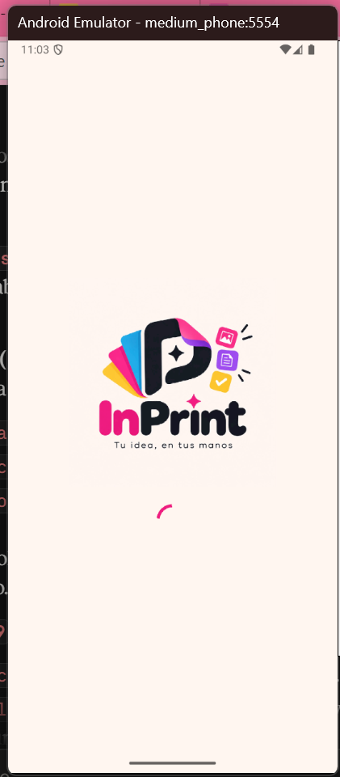
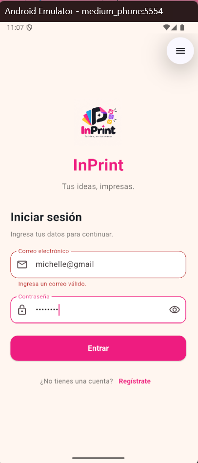
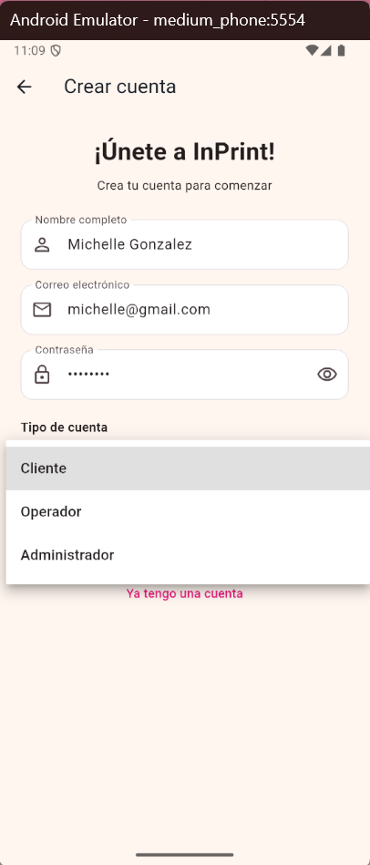
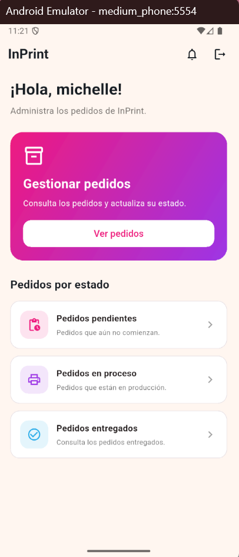
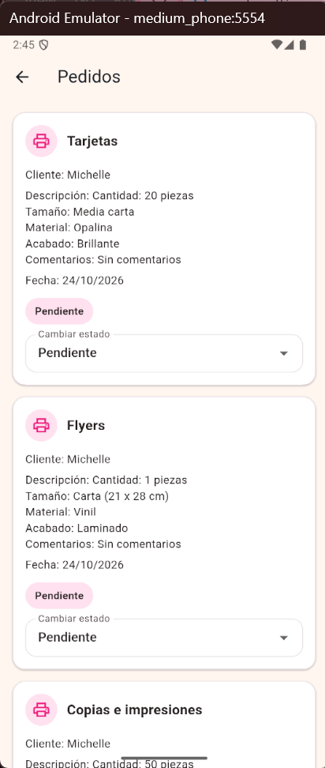
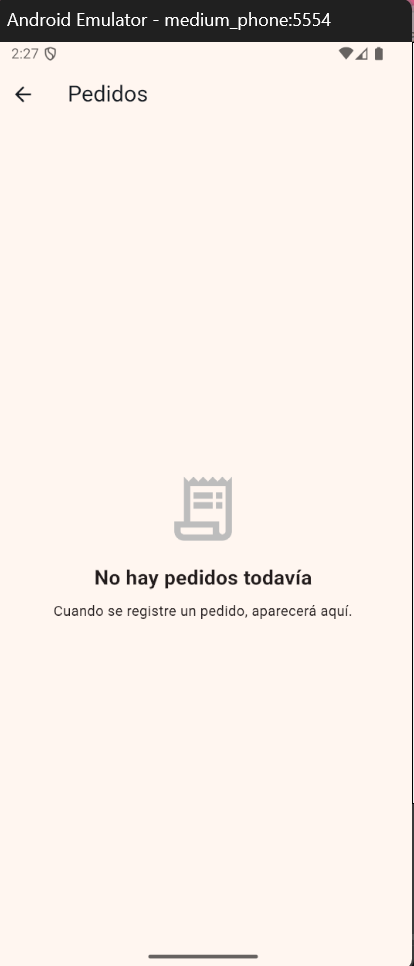
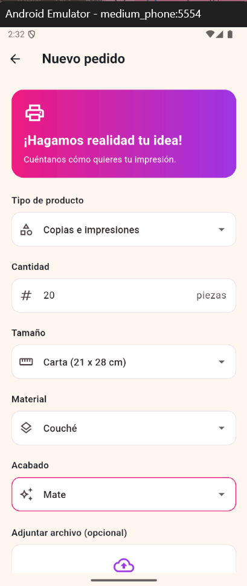
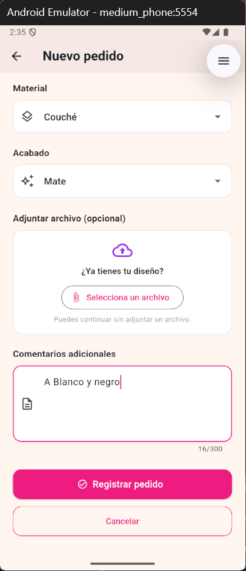
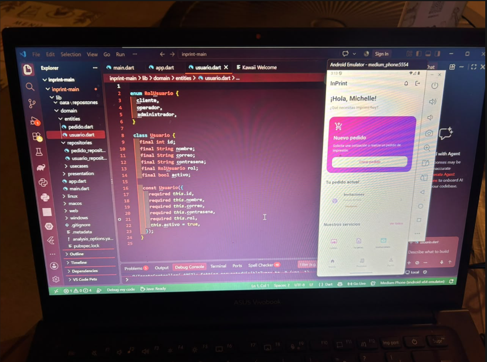
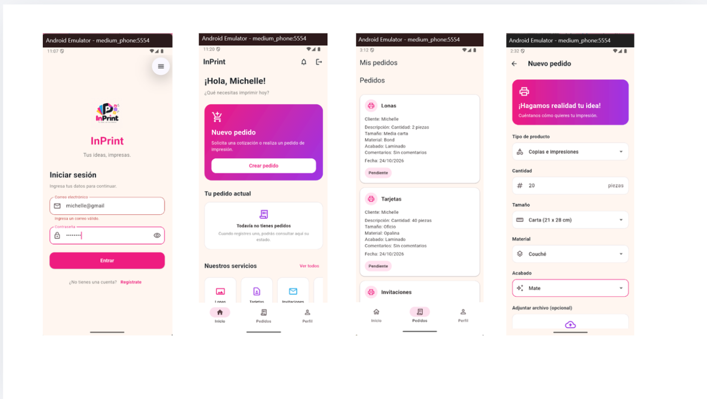

# InPrint

## 1. Descripción breve
InPrint es una aplicación móvil para solicitar y gestionar pedidos de impresión (lonas, tarjetas, invitaciones, flyers, copias e impresiones). Permite que un cliente cree su pedido, que un operador administre su estado y que un administrador consulte pedidos, usuarios y reportes del negocio.

## 2. Los 3 tipos de usuario y sus dashboards
- **Administrador:** panel de administración con acceso a Pedidos, Usuarios y Reportes.
- **Cliente:** dashboard con acceso a "Nuevo pedido", su pedido actual, sus pedidos y los servicios disponibles.
- **Operador:** dashboard "Gestionar pedidos" con pedidos pendientes, en proceso y entregados, donde puede cambiar el estado de cada pedido.

## 3. Manejo de estado elegido (y por qué)
Se utilizó **Provider** para el manejo de estado, por las siguientes razones:
- Conserva el usuario autenticado y su rol mientras se navega, para mostrar el dashboard que le corresponde.
- Comparte la lista de pedidos entre las vistas del cliente y del operador, de modo que cuando el operador cambia el estado de un pedido, el cambio se refleja en las listas.
- Es sencillo de implementar, requiere poco código repetitivo y separa la lógica de la interfaz.

## 4. Cómo ejecutar la app
1. Clonar el repositorio: `git clone [https://github.com/pamichelle/Inprint_aplicacion.git]`
2. Entrar a la carpeta del proyecto: `cd inprint-main`
3. Instalar dependencias: `flutter pub get`
4. Abrir un emulador Android o conectar un dispositivo físico.
5. Ejecutar la app: `flutter run`

## 5. Screenshots

### Splashscreen

### Autenticación

### Dashboards

### Listas

### Formularios

### Evidencia funcional

